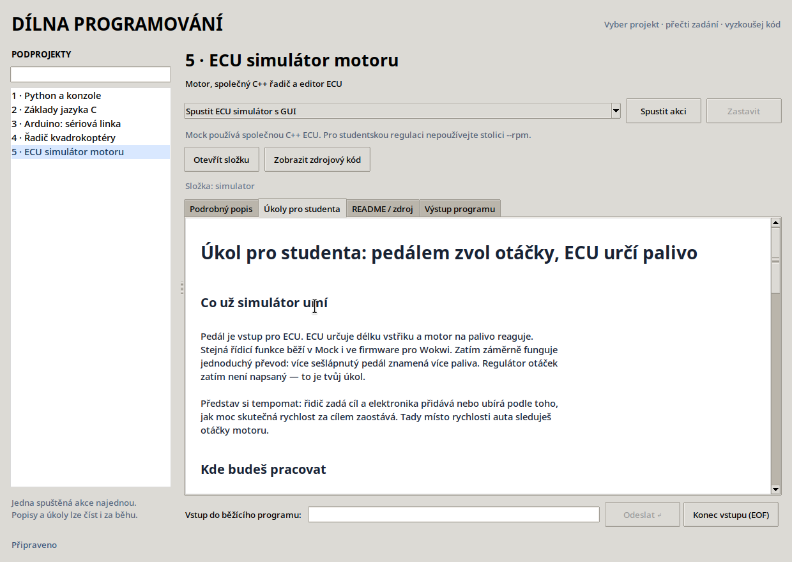

# Základy programování · centrální spouštěč

Z jednoho okna otevřeš podprojekty, přečteš podrobný popis, zobrazíš studentské
zadání a spustíš příslušný program nebo sestavení.

```bash
python3 spustit.py
# nebo na Linuxu:
./spustit.sh
```

Spouštěč používá pouze standardní Python a Tk. Na Debianu/Ubuntu lze chybějící
GUI modul doplnit balíčkem `python3-tk`. Podprojekty mají vlastní požadavky;
spouštěč nástroje automaticky neinstaluje. Funguje i při spuštění z jiné složky.



## Projekty

| Projekt | Akce | Studijní obsah |
| --- | --- | --- |
| Python a konzole | Python příklady, soubory, Bash/Git, PowerShell | syntax, podmínky, cykly, soubory |
| Základy C | překlad a spuštění dvou C17 programů | typy, pole, funkce, soubory |
| Arduino / sériová linka | editor, PlatformIO build, volitelný Wokwi CLI běh | LED, sériové příkazy, ADC, krokový motor |
| Kvadrokoptéra | editor, PlatformIO build, volitelný Wokwi CLI běh | IMU, regulátor, ARM, směšování |
| Databáze kontaktů (pátá hodina) | překlad a spuštění varianty se šablonou či dědičností, editor | objekty, šablony, polymorfismus, pět formátů kontaktů |
| ECU simulátor | samostatné GUI, konzolový Mock, editor projektu | motor a společná C++ ECU |

**Pátá hodina:** [databáze kontaktů – šablony a dědičnost v C++](patahodina/README.md).
Obě varianty lze přeložit a spustit ze společného spouštěče; vyžadují CMake, C++17 a libxml2.

**Aktuální ECU úkol:** [automatická regulace otáček motoru](simulator/docs/ukol_regulace_otacek.md).
Student má upravit `update_control()` v ECU: pedál zadá požadované otáčky,
regulátor určí palivo podle skutečných otáček. Výchozí kód stále používá přímý
převod pedál → palivo; hotové řešení úkolu se nezapíná.

## Ovládání rozcestníku

Vlevo vyber projekt nebo jej vyhledej. Záložky obsahují **Podrobný popis**,
**Úkoly pro studenta**, původní **README / zdroj** a **Výstup programu**.
Vyber konkrétní akci a stiskni **Spustit akci**. Konzolový výstup se zobrazuje
průběžně; odpovědi na otázky zadávej dole a odešli Enterem. Tlačítko EOF ukončí
vstup. Zastavit přeruší běžící akci. Zavření rozcestníku nejprve požádá spuštěný
program o ukončení a čeká na jeho úklid; čekání neblokuje Tk okno.

Běží jedna spravovaná akce najednou; ostatní popisy a úkoly lze číst i během ní.
ECU má vlastní okno. Otevření Wokwi projektu v editoru samo simulaci nespouští:
nejdřív sestav firmware, pak v editoru použij **Wokwi: Start Simulator**.
Volitelná CLI akce běží šest virtuálních sekund, vyžaduje `WOKWI_CLI_TOKEN`
v prostředí a může čerpat CI kvótu. Spouštěč token nezobrazuje ani neukládá.

C programy se překládají před každým spuštěním do ignorovaného `.cache/launcher`.
Při chybě překladu se stará binárka nespustí. Souborové úlohy používají původní
vstupy a přepisují `sude.txt`/`liche.txt` v podprojektu; upozornění je i u jejich akcí.
GUI uchovává omezený konec výstupu, aby jej dlouhý běh nezahltil.

## Terminál bez GUI

```bash
python3 spustit.py --list
python3 spustit.py --describe ecu
python3 spustit.py --tasks ecu
python3 spustit.py --run python --action zaklady
python3 spustit.py --run c --action soubory
python3 spustit.py --run ecu --action konzole
```

ID projektů a akcí vypíše `--list`. Terminálové spuštění používá přímo stdin/stdout,
takže funguje také interaktivní vstup. Chybějící nástroj oznámí konkrétní zpráva.
ECU přednostně používá `simulator/.venv/bin/python`; ostatní Python příklady
interpret, kterým byl spuštěn rozcestník. PlatformIO, Wokwi CLI a editor se hledají
v PATH a u PlatformIO/Wokwi také v obvyklých místních umístěních.

## Rozšíření a ověření

Katalog je v `launcher/catalog.py`, podrobné popisy a běžná zadání v
`launcher/materialy/`. ECU zadání se čte přímo ze simulátoru, takže nevzniká druhá
kopie. Pro další podprojekt přidej položku `Project`, jeho akce a cesty k dokumentům.

```bash
PYTHONDONTWRITEBYTECODE=1 python3 -m unittest discover -s tests -v
# Skutečné Tk testy na dostupném displeji:
LAUNCHER_TEST_GUI=1 PYTHONDONTWRITEBYTECODE=1 python3 -m unittest discover -s tests -v
```

Testy rozcestníku ověřují katalog, postup překladu/spuštění, vstup/výstup,
ukončení, chybové stavy a GUI. Samy neprokazují běh MCU ve Wokwi.
