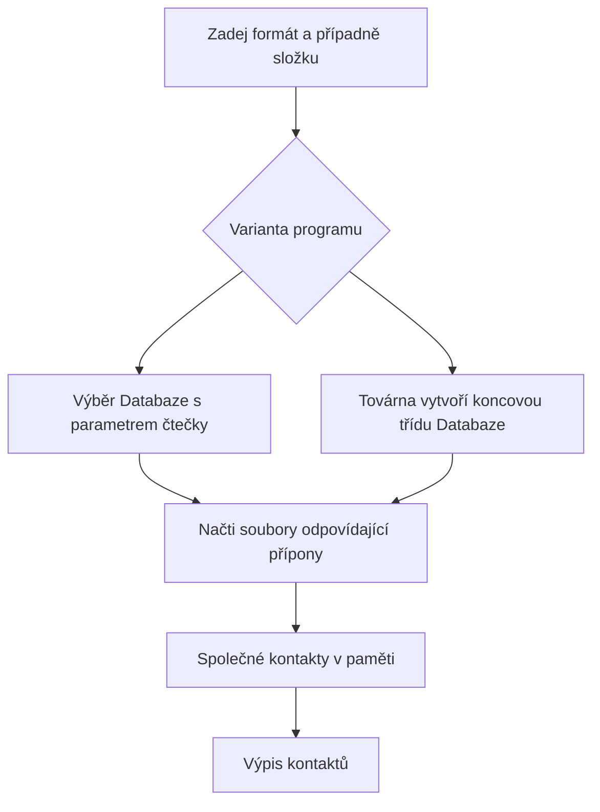

# Pátá hodina: znovupoužitelný kód – databáze kontaktů

Dva hotové konzolové programy v **C++17** načítají stejné kontakty.
První používá **šablonu třídy**, druhý **dědičnost a virtuální metodu**.
Databáze je zde kolekce v paměti naplněná ze souborů; nepotřebuje databázový server.
Všechna jména a kontaktní údaje jsou smyšlené výukové příklady.

## Python varianta

Stejná databáze je připravena také v [Pythonu](python/README.md): generická
třída jako protějšek šablony a samostatná varianta s dědičností. Obě jsou dostupné
ve společném spouštěči a využívají stejné kontakty. Stačí Python 3.10+, bez dalších
balíčků. Python generika nevytvářejí specializované třídy jako C++ šablony.

## Krátce o objektech a šablonách

**Třída** je předpis, jaká data a operace budou patřit k sobě.
**Objekt** je konkrétní instance této třídy vytvořená v paměti.
Například `Databaze<Json>` je typ a proměnná `db` je objekt tohoto typu.
Dva objekty stejné třídy mohou mít každý své vlastní kontakty.

Data uložená v objektu nazýváme **atributy** (zde `data`). Funkce, které
s objektem pracují, nazýváme **metody** (zde `nacti()` a `zobraz()`).
`private` skrývá vnitřní stav před okolím, `public` zpřístupňuje rozhraní
programu a `protected` dovoluje přístup také odvozeným třídám.
U `class` je výchozí přístup soukromý; u `struct` veřejný.
Proto je i jednoduchý `Kontakt` třídním typem a jednotlivé kontakty jsou objekty.

```cpp
Databaze<Json> db;     // Vytvoř objekt databáze pro JSON.
db.nacti(slozka);     // Metoda uloží načtené kontakty do objektu.
db.zobraz();          // Jiná metoda zobrazí stav stejného objektu.
```

**Dědičnost** umožňuje odvodit novou třídu od společného základu.
`JsonDatabaze` je konkrétní druh `Databaze`. Základ říká, co musí databáze
umět; odvozená třída určuje, jak se data načtou. Základ s metodou
`virtual void nacti(...) = 0` je abstraktní: samotný objekt tohoto základu
vytvořit nemůžeme. Přes ukazatel na něj ale můžeme ovládat konkrétní databázi.
Volání správné přepsané metody podle skutečného typu objektu se nazývá
**polymorfismus**. `override` nechá překladač ověřit, že metodu opravdu přepisujeme.

**Šablona** je předpis s parametrem, například s typem čtečky.
Zápis `template<class Ctecka>` říká, že jméno `Ctecka` zastupuje konkrétní typ,
který dodáme při použití. `Databaze<Json>` a `Databaze<Csv>` tak využívají
stejný zdrojový kód, ale překladač z něj vytvoří různé typy.
Obě čtečky musí poskytovat operace, které šablona používá; při jejich chybění
se program nepřeloží. Zadaný text `json` za běhu pouze vybere už přeloženou variantu.

Objekty používají **obě ukázky**. Šablona určuje podobu konkrétního typu
při překladu, zatímco dědičnost dovoluje pracovat s různými objekty přes
společné rozhraní za běhu. Podrobnosti můžeš sledovat přímo v komentářích programů.

## Soubory

```text
patahodina/
├── kontakty/
│   ├── xml/       # 6 souborů .xml
│   ├── json/      # 6 souborů .json
│   ├── vcard/     # 6 souborů .vcf
│   ├── csv/       # 6 souborů .csv
│   └── txt/       # 6 souborů .txt
├── spolecne/kontakty.hpp  # Kontakt, čtečky, načítání složky, vstup a výpis
├── sablony/main.cpp       # Databaze<Ctecka>
├── dedicnost/main.cpp     # abstraktní Databaze a pět koncových tříd
├── tests/overeni.py       # ověření obou skutečných programů
└── CMakeLists.txt
```

Každý soubor obsahuje **jeden kontakt** s poli jméno, e-mail a telefon.
Stejných šest osob je zapsáno v každém formátu: celkem **30 souborů**.
Program načte všechny soubory odpovídající přípony z vybrané složky, seřazené
podle názvu. Ostatní přípony přeskočí. Při chybě vypíše důvod, u vadného
souboru také jeho cestu, a skončí s návratovým kódem 1. Neúplná databáze se nevypisuje.

## Společný spouštěč

Z kořene repozitáře spusť `python3 spustit.py` a vyber **Databáze kontaktů**.
Zvol variantu se šablonou nebo s dědičností. Spouštěč nejprve program sestaví;
až se objeví otázka na formát, zadej dole například `json` a odešli Enterem.
Při chybě sestavení se program nespustí. Závislosti nainstaluj podle návodu níže.

```bash
python3 spustit.py --run kontakty --action sablony
python3 spustit.py --run kontakty --action dedicnost
```

## Sestavení a spuštění

Potřebuješ překladač C++17, CMake a vývojovou knihovnu libxml2.
Na Debianu/Ubuntu/WSL je nainstaluješ:

```bash
sudo apt install g++ cmake libxml2-dev python3
```

Z kořene repozitáře:

```bash
cmake -S patahodina -B patahodina/build
cmake --build patahodina/build

# Bez argumentů se program nejprve zeptá na formát:
./patahodina/build/kontakty_sablony
./patahodina/build/kontakty_dedicnost

# Nebo zadej formát rovnou při spuštění:
./patahodina/build/kontakty_sablony json
./patahodina/build/kontakty_dedicnost xml
./patahodina/build/kontakty_sablony vcard
./patahodina/build/kontakty_dedicnost csv
./patahodina/build/kontakty_sablony txt

# Volitelný druhý argument je složka s vlastními soubory:
./patahodina/build/kontakty_dedicnost txt ./patahodina/kontakty/txt

ctest --test-dir patahodina/build --output-on-failure
```

Výchozí cesta k datům je při sestavení vložena do programu, proto binárku můžeš
spustit i z jiné pracovní složky. Po přesunutí projektu ji znovu sestav nebo zadej
vlastní cestu. Typ se píše malými písmeny: `xml`, `json`, `vcard`, `csv`, `txt`.
Ukázka výstupu:

```text
Načteno kontaktů: 6
Anna Nováková | anna@example.test | +420111000001
Petr Svoboda | petr@example.test | +420111000002
...
```

## Jak se kód znovu používá

Společná struktura `Kontakt` popisuje data bez ohledu na jejich zápis na disku.
Každá čtečka (`Json`, `Xml`, `Csv`, `Txt`, `Vcard`) má stejnou dvojici členů:
`pripona` a `nacti(cesta)`. Výsledkem čtení je vždy `Kontakt`.
Algoritmus `nacti_slozku<Ctecka>` řeší hledání souborů, řazení a hlášení chyb
jednou pro všechny formáty. XML zpracovává libxml2, ostatní čtečky jsou malé
komentované ukázky v projektu.

### Varianta se šablonou

`Databaze<Json>` a `Databaze<Xml>` jsou dva různé konkrétní typy vytvořené
překladačem ze stejné definice `template<class Ctecka> class Databaze`.
`spust<Json>()` vytvoří databázi, načte složku a zobrazí kontakty.
Větvení v `main()` podle uživatelského vstupu vybírá jednu z již přeložených
variant. Parametr šablony se neurčuje až za běhu ze zadaného textu.

### Varianta s dědičností

Abstraktní `Databaze` předepisuje čistě virtuální `nacti()` a nabízí společný
výpis. Koncové třídy `JsonDatabaze`, `XmlDatabaze`, `VcardDatabaze`,
`CsvDatabaze` a `TxtDatabaze` přepisují načítání pomocí `override`.
Tovární funkce `vytvor()` vrací `std::unique_ptr<Databaze>`; kostra programu
potom volá stejné `db->nacti()` bez znalosti konkrétní třídy.
Virtuální destruktor zajistí správné zrušení objektu přes ukazatel na základ.
I tato varianta znovu používá společný pomocný algoritmus se šablonou;
rozdíl ukázek je v návrhu a výběru samotné databáze.



| Vlastnost | Šablona | Dědičnost |
| --- | --- | --- |
| Společná definice | `Databaze<Ctecka>` | abstraktní `Databaze` |
| Konkrétní varianta | `Databaze<Json>` | `JsonDatabaze` |
| Propojení s čtečkou | při překladu | virtuální volání za běhu |
| Přístup v kostře | `spust<Json>()` | `unique_ptr<Databaze>` |
| Přidání formátu | čtečka a větev výběru | čtečka, koncová třída a větev továrny |

## Výukové profily formátů

- JSON: jeden objekt s textovými poli `jmeno`, `email`, `telefon`; diakritika
  přímo v UTF-8. Běžné krátké escape sekvence jsou podporovány, `\uXXXX`, pole,
  vnořené objekty a netextové hodnoty se odmítají.
- XML: kořen `kontakt` a přímé podprvky `jmeno`, `email`, `telefon`.
  XML entity jako `&amp;` řeší knihovna. DTD se odmítá.
- CSV: hlavička `jmeno,email,telefon` a jediný datový řádek; podporované jsou
  uvozovky, čárka uvnitř uvozovek a zdvojené uvozovky. Víceřádková pole ne.
- TXT: tři řádky `jmeno=...`, `email=...`, `telefon=...`.
- vCard: základní profil 3.0 s `BEGIN:VCARD`, `VERSION:3.0`, `FN`, `EMAIL`,
  `TEL`, `END:VCARD`; soubory mají i strukturované jméno `N`. Čtečka využívá
  zobrazované jméno `FN`; nepodporuje skládání řádků, parametry ani escapování.

Jde o ukázku návrhu programu, nikoli univerzální importér libovolných kontaktů.
Čtečky kontrolují povinná neprázdná pole a duplicity, neplatnost e-mailové adresy
nebo telefonního čísla ale neposuzují.

## Úkoly pro studenta

Zadání najdeš v [UKOLY.md](UKOLY.md) i v záložce společného spouštěče.
