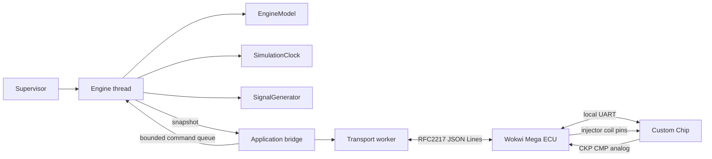

# ECU Simulator – druhá fáze

Výukový SIL čtyřtaktního motoru: Python model v samostatném vlákně,
virtuální čas, CKP/CMP, události ECU a obnovitelné RFC2217 spojení.
Výchozí motor má čtyři válce a CKP 60-2. Nejde o kalibrovaný model spalování.

**Stav:** Python testy, hostitelský test chipu, skutečný lokální RFC2217 test,
build firmware a WASM a Wokwi lint jsou ověřené. Běh uzavřené smyčky ve Wokwi
ani přesnost virtuálních pinů zatím ověřené nejsou: CLI nemá `WOKWI_CLI_TOKEN`.
Podrobnosti a postup přijetí jsou v [akceptaci](docs/acceptance.md).

## Linux: instalace a spuštění

Adresář projektu se historicky jmenuje `simulator ` **s mezerou na konci**.
Z kořene repozitáře:

```bash
cd 'simulator '
python3 -m venv .venv
. .venv/bin/activate
python -m pip install -r requirements.txt
python main.py --mode mock --duration 10
python main.py --mode mock --rpm 1200 --load 20 --speed 0.5 --duration 10 \
  --telemetry /tmp/ecu-telemetry.jsonl
```

`--duration` je skutečná doba běhu; `--speed 0.5` posune virtuální čas přibližně
o polovinu. `--step-us 1000` určuje pevný virtuální krok (povoleno 1–100000 µs).
`--rpm` zapne stolici s pevně drženými otáčkami; bez něj otáčky vyplynou z momentu,
setrvačnosti a zatížení. `--load` je moment v Nm, `--throttle` rozsah 0–1.
`--config engine_config.json` nastavuje válce, setrvačnost, limity a geometrii snímačů.
Výpis ukazuje simulační čas, RPM, MAP, lambdu, stav linky a ztracené hrany.
`Ctrl+C` ukončí pracovní vlákna; nedostupný server nezastaví model.

## Komponenty



- `model.py`: čistý model momentu, setrvačnosti, zatížení a výstupů ECU.
- `clock.py`: celočíselný virtuální čas, bez fyziky a transportu.
- `signals.py`: neměnné hrany CKP/CMP interpolované z úhlové dráhy.
- `engine.py`: modelové vlákno, zamčené snímky, omezené fronty, časované povely.
- `protocol.py`: validace a omezené JSON Lines rámování.
- `transport.py`: nezávislé `open/read/write/close`, pracovní vlákno a reconnect.
- `bridge.py`: překlad aplikačních zpráv, Mock a měření RTT/offsetu hodin.
- `supervisor.py`: start, pause, resume, restart, close; žádný model spalování.

Pro nový backend stačí implementovat transportní rozhraní a předat
`transport_factory` do `RFC2217Bridge`; model ani hodiny se nemění.

Programové řízení:

```python
from supervisor import Supervisor
app = Supervisor()
try:
    app.start()
    app.pause()
    app.engine.command({'load_nm': 20})
    app.resume()
    app.bridge.tick()
    print(app.engine.snapshot())
    app.restart()  # hostitelský model a jeho čas znovu od nuly
finally:
    app.close()
```

Po restartu hostitele restartujte i Wokwi firmware: transport neumí resetovat MCU.
Původní CLI `--mode mock/wokwi --url --duration --throttle --rate` zůstává zachováno;
`Engine.command()` je nyní fronta aplikovaná v následujícím kroku. Staré JSON povely
`{"type":"actuators",...}` nejsou na drátu přijímány: demo používá úplnou obálku v1.
Přímé programové `MockBridge.receive()` zachovává starý tvar kvůli původním experimentům.

## Wokwi demonstrační projekt

Používá Arduino Mega 2560 kvůli samostatnému UART pro hostitele a chip.
Zdroj i zapojení jsou v `wokwi/`; vestavěná LED bliká při cyklech výstupů ECU.

```bash
# Z adresáře simulator :
python -m pip install platformio
pio run -d wokwi
cd wokwi
# Oficiální wokwi-cli musí být v PATH:
wokwi-cli chip compile engine-signals.chip.c -o engine-signals.chip.wasm
wokwi-cli lint .
cd ..
```

Ve VS Code/VSCodium vyberte `wokwi/wokwi.toml` příkazem **Wokwi: Select Config File**,
pak **Wokwi: Start Simulator**. Panel simulace ponechte viditelný.
Poté v druhém terminálu, z adresáře `simulator `:

```bash
python main.py --mode wokwi --url rfc2217://localhost:4000 --baudrate 1000000 \
  --throttle 0.35 --duration 30 --telemetry /tmp/ecu-wokwi.jsonl
```

Výchozí baudrate Pythonu zůstává 115200 pro původní projekty. Nové demo a lokální
UART chipu používají **1000000 baud**. Doporučený demonstrační rozsah je 300–2000 RPM;
při vyšších otáčkách není průchodnost všech JSON událostí garantovaná. Sledujte
ztráty a `CAPTURE_OVERFLOW` v Chips Console. Firmware při nepřijetí stavu po 1 s
přestane zahajovat nové impulzy a zastaví lokální snímače; již otevřené impulzy dokončí.

Chip generuje 60-2/CMP v čase Wokwi a převádí MAP/TPS/IAT/CLT/lambdu na analogové piny.
Piny ECU zachycuje přes `pin_watch`, značkuje `get_sim_nanos()` a posílá přes UART
zpět firmwaru, který tvoří `ecu_event`. Jeho řadič používá RPM telemetrii pro jednoduchou
regulaci paliva. Čte počty CKP/CMP, ale zatím nejde o plnohodnotnou zubově řízenou ECU.

**Lokální chip není deterministickým přehrávačem Python hran.** Vlastní úhel integruje
z poslední hodnoty RPM; fáze motoru na hostiteli a MCU se může rozcházet.
Pythonové `--speed` neřídí rychlost Wokwi. Časové domény popisuje
[dokument synchronizace](docs/timing.md). Samotný úspěšný přenos JSON nesplňuje
akceptaci přesných pinů.

## Automatické ověření

Z adresáře `simulator `:

```bash
PYTHONDONTWRITEBYTECODE=1 python -m unittest discover -s tests -v
# Navíc skutečný TCP server jen na loopbacku; potřebuje oprávnění otevřít socket:
ECU_TEST_TCP=1 PYTHONDONTWRITEBYTECODE=1 python -m unittest discover -s tests -v
# Hostitelský C test skutečného zdroje chipu s náhradami Wokwi API:
clang -std=c11 -Wall -Wextra -Werror -Wno-unknown-attributes -Wno-unused-function \
  -I wokwi tests/chip_host_test.c -lm -o /tmp/ecu-chip-test
/tmp/ecu-chip-test
```

Časovací testy používají virtuální kroky; čekání s timeoutem je pouze v testech
životního cyklu a I/O. C test nenahrazuje běh WebAssembly ve Wokwi.

## Další dokumentace

- [Protokol a model ECU](docs/protocol.md)
- [Časování, bezpečnost vláken a omezení](docs/timing.md)
- [Evidence a integrační akceptace](docs/acceptance.md)

Oficiální podklady: [RFC2217 konfigurace](https://docs.wokwi.com/vscode/project-config),
[Time API](https://docs.wokwi.com/chips-api/time),
[GPIO](https://docs.wokwi.com/chips-api/gpio), [UART](https://docs.wokwi.com/chips-api/uart),
[analogové API](https://docs.wokwi.com/chips-api/analog),
[sestavení WASM](https://docs.wokwi.com/guides/custom-chips-to-wasm).
Dodané `wokwi-api.h` pochází z https://wokwi.com/api/chips/wokwi-api.h (14. 11. 2026).
