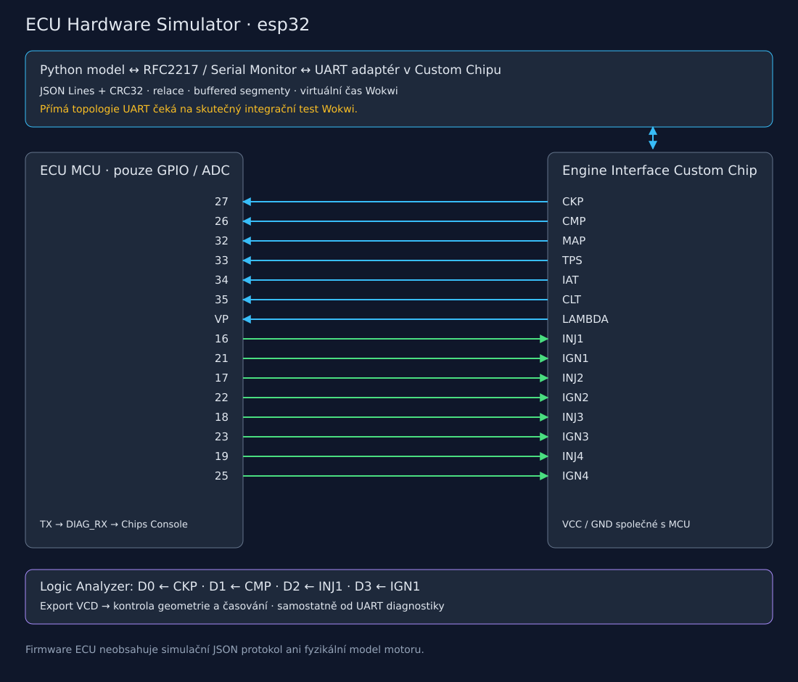
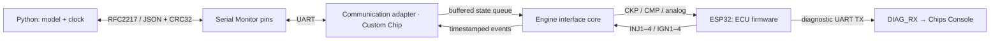

# ECU Hardware Simulator – Wokwi

Samostatný projekt podle zadání virtuálního hardware. Výchozí MCU je ESP32,
čtyři válce, sekvenční vstřikování, samostatné cívky, CKP 60-2 a CMP 720°.
Fyzikální model zůstává výhradně v Pythonu. Demonstrační ECU získává otáčky
z GPIO CKP, fázi z CMP a snímače z ADC; nečte simulační JSON ani RPM z hostitele.

**Stav: sestaveno a nativně testováno; skutečná integrace Wokwi není přijata.**
Ještě je nutné ověřit přímou cestu Serial Monitor ↔ UART Custom Chipu ve Wokwi,
spuštění MCU, skutečný VCD a propojenou smyčku s Pythonem. Pokus o CLI běh skončil
`Missing WOKWI_CLI_TOKEN environment variable`. [Výsledky](VERIFICATION.md)
rozlišují jednotlivé důkazy a otevřené body.

## Topologie a hranice firmware





Serial Monitor je explicitně připojen na RX/TX Custom Chipu, **nikoli na ECU**.
Adaptér tvoří oddělené C moduly `adapter.c` a `json.c`; nemá přístup k síti.
ECU UART slouží jen vlastním diagnostickým řádkům v Chips Console. Simulační
rámce proto nemísíme s boot logem a diagnostikou produkčního firmware.

Dokumentace Wokwi [nepodporuje propojené dva MCU v jedné simulaci](https://docs.wokwi.com/faq).
Druhý MCU tedy není skrytým předpokladem této topologie. Explicitní zapojení
[pinů Serial Monitoru](https://docs.wokwi.com/guides/serial-monitor) a
[UART API chipu](https://docs.wokwi.com/chips-api/uart) jsou dokumentované
stavební prvky; jejich přímé propojení přes RFC2217 v této sestavě je zatím
**technický prototyp**, nikoli ověřená vlastnost Wokwi. Pokud runtime tento přenos
neumožní, nepřesouvat protokol do ECU: pokračovat odděleným podporovaným transportem
(viz [protokol a alternativy](protocol/README.md)).

## Build a spuštění ve VS Code / VSCodium

Z kořene repozitáře:

```bash
cd 'simulator '
. .venv/bin/activate
python -m pip install -r requirements.txt platformio
# Oficiální wokwi-cli musí být v PATH:
python wokwi/hardware/scripts/build.py
```

Skript vygeneruje konfiguraci, sestaví ESP32 firmware a WASM a provede lint.
Samostatně lze provést:

```bash
python wokwi/hardware/scripts/configure.py
pio run -d wokwi/hardware -e esp32
cd wokwi/hardware/chips/engine-interface
wokwi-cli chip compile engine-interface.chip.c hw_core.c adapter.c json.c \
  -o engine-interface.chip.wasm
cd ../..
wokwi-cli lint .
```

Ve VS Code vyberte **Wokwi: Select Config File → hardware/wokwi.toml** a potom
**Wokwi: Start Simulator**. Panel ponechte viditelný. V novém terminálu,
z adresáře `simulator `:

```bash
# Společnou geometrii, válce a komunikaci načte z config/engine.json:
python wokwi/hardware/scripts/run_host.py --gui --telemetry /tmp/ecu-hardware.jsonl
# Ekvivalent bez wrapperu:
python main.py --mode wokwi --wokwi-hardware --gui --baudrate 1000000 \
  --hardware-mode buffered --lookahead-us 100000 --telemetry /tmp/ecu-hardware.jsonl
```

Začněte se skutečným tempem `--speed 1`, výchozím `--rate 20` a 1000 RPM
(`--rpm 1000`) pro měření signálů. Pro uzavřenou regulační vazbu `--rpm` vynechte;
ECU má pevnou vstřikovací dávku/předstih, nejde o hotový regulátor volnoběhu.
`--wokwi-hardware` vybere ochranu CRC32 a relace; při neuvedeném baudrate nastaví
1 Mbaud. Původní profil `--mode wokwi` bez tohoto přepínače zůstává kompatibilní
s historickým Mega demem, ale pro tento projekt se nepoužívá.

`link=True` samo potvrzuje pouze TCP spojení. Funkční adaptér prokážou až rostoucí
přijaté `clock_sync`/`hardware_status`, reakce ADC, CKP/CMP a ECU výstupy ve VCD.

## Konfigurace

- `config/engine.json`: válce/kanály, CKP, CMP, polarity, poruchy, křivky snímačů,
  timeouty, baudrate, buffered lookahead a parametry demonstrační ECU.
- `config/pinout.json`: MCU, mapování GPIO a fyzické názvy pinů Wokwi.
- `config/PINOUT.md`: generovaný přehled vodičů; stejné údaje používá diagram.
- `config/generated_hw.h`, `firmware/include/generated_pins.h`, `diagram.json`
  a `wokwi.toml`: generované artefakty, neupravovat ručně.

Po změně JSON spusťte build. `configure.py --check` kontroluje shodu artefaktů
s konfigurací; odmítá překryv GPIO, neplatné rozsahy, nesetříděné křivky a CMP překryv.
Demonstrační profil podporuje 1–4 válce, pevně má k dispozici čtyři nezávislé INJ
vstupy a čtyři IGN vstupy. V JSON lze volit vynechaný CKP zub, rušivý impulz,
CMP fázový posun či zablokovaný CMP a polarity. Výchozí poruchy jsou vypnuté.

CKP duty je podíl zubové rozteče, CMP pozice/šířka jsou v úhlových stupních.
Demo decoder potřebuje chybějící zuby a jednoznačný referenční CMP; obecnější
víceimpulzová CMP geometrie je podporována chipem, ale vyžaduje přizpůsobení decoderu
ECU pro dané kolo. Wrapper hostitele předá Pythonu počet válců a geometrii CKP/CMP ze stejné konfigurace.
Ostatní fyzikální parametry přebírá z `simulator /engine_config.json`; dočasný soubor
po ukončení odstraní. Ruční spuštění `main.py` vyžaduje shodu konfigurací; úmyslný
`--config` ve wrapperu výchozí sestavenou konfiguraci přepíše.

Analogové převody jsou kalibrační tabulky s interpolací a saturací. IAT/CLT používají
parametrický NTC dělič (R25, B, pull-up, napájení) převedený na tabulku. Výchozí MAP
je příklad lineární charakteristiky s dělením napětí 0.66; TPS a lambda jsou výukové
kalibrace. Nejsou prohlášením o konkrétním reálném snímači. Výchozí ESP32 zapojení
drží napětí pod 3.3 V. Křivky mohou být konfigurované do 5 V, musí však odpovídat
cílovému MCU a reálnému vstupnímu obvodu. Wokwi má omezenou analogovou simulaci;
[Analog API](https://docs.wokwi.com/chips-api/analog) uvádí virtuální ADC referenci
5 V. Ověření ADC na konkrétním MCU je samostatný integrační bod.

Další MCU nevyžaduje změnu modelu ani chipu: upravuje se profil pinů a tenká
vrstva GPIO/timeru ve `firmware/src/main.cpp`. Připravený profil Mega je především
kontrola přenositelnosti sestavení:

```bash
python wokwi/hardware/scripts/build.py --target mega
# Poté znovu výchozí ESP32:
python wokwi/hardware/scripts/build.py --target esp32
```

Časovou výkonnost Mega nelze převzít z ESP32; build ji neověřuje.

## Časování

Preferovaný režim **buffered**: první platný rámec založí relaci a mapování epoch.
Hostitelský vzorek s časem t se provede v chipu v `origin_wokwi + (t-origin_host)
+ lookahead`. Výchozí lookahead je 100 ms, fronta má 64 stavů. Není zde přepočet
motorové fyziky ani předpověď budoucího spalování: přehráváme zpožděnou trajektorii
vypočtenou Pythonem. Začátkem první aplikace se ukotví úhel; další stavy mění RPM
a snímače, zachovají spojitou úhlovou dráhu a vykážou fázovou odchylku vůči hostiteli.

CKP/CMP termíny se odvozují z nejbližšího překročení úhlu a přepočtou při nové RPM.
Wokwi wrapper používá jednorázový virtuální časovač; service timer pro UART a
status neslouží ke generování hran. Události se značkují 64bitovými µs času Wokwi,
navíc nesou mapovaný čas hostitele. Plánování je s rozlišením 1 µs, které nenahrazuje
naměřenou přesnost skutečného runtime. Model mezi aktualizacemi extrapoluje konstantní
RPM; fázová odchylka a latence musí být změřeny při dynamických změnách.

Pozdní stav se odmítne, nepřehraje se okamžitě jako hrana. Budoucí aplikace má limit
2 s. Při vyčerpání bufferu se nejvýše po watchdog intervalu (výchozí 1 s od poslední
aplikace) CKP/CMP zastaví a rozpracované zachycené pulzy se explicitně uzavřou jako
chybné. Produkční výstupy chip nedrží ani násilně neřídí: bezpečné vypnutí vlastních
GPIO po ztrátě CKP musí obsloužit ECU, demo to testuje.

**Free-running** aplikuje poslední platnou RPM při zpracování rámce a dále plánuje
hrany lokálně. Není synchronizovaný s hostitelem. **Step-controlled** není podporován
ani prezentován jako hotový. Pause/speed Pythonu neřídí Wokwi hodiny: při pauze
hostitele dojde k vyčerpání bufferu/watchdog, při rozdílném tempu mohou aktualizace
přicházet pozdě. Nezvyšujeme automaticky rychlost ani neopakujeme placené simulace.

## Testy a měření

Z adresáře `simulator `:

```bash
PYTHONDONTWRITEBYTECODE=1 python -m unittest discover -s wokwi/hardware/tests -v
PYTHONDONTWRITEBYTECODE=1 python -m unittest discover -s tests -v
```

Hardware testy potřebují hostitelský C a C++ překladač (`clang`/`gcc` a `clang++`/`g++`).
Sestaví skutečné `hw_core.c`, `adapter.c` a logiku ECU, posouvají virtuální čas,
zkouší zuby, CMP, zrychlení/zpomalení, zastavení, polarity/poruchy, vstřikování,
dwell/jiskru, analogové hodnoty, CRC, fronty, neplatné rámce, reset a watchdog.
Test Python bridge → nativní adaptér → časované ECU události → Python model ověřuje
kompatibilitu protokolu. Nativní test GPIO → decoder ECU → výstupy → capture ověřuje
propojení logiky. Ani jeden není spuštěním ESP32 instrukcí nebo WASM ve Wokwi.

[VERIFICATION.md](VERIFICATION.md) obsahuje postup pro skutečný technický prototyp,
statický scénář UART a VCD, runtime smyčku, pauzu i latenci. Simulační JSON, úspěšný
build nebo lint samy nesplňují akceptaci Wokwi.
