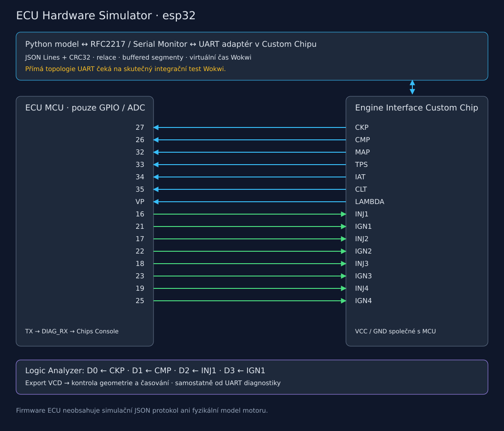

# Generovaná pinmapa – esp32

| Custom Chip | ECU pin |
| --- | --- |
| CKP | 27 |
| CMP | 26 |
| MAP | 32 |
| TPS | 33 |
| IAT | 34 |
| CLT | 35 |
| LAMBDA | VP |
| INJ1 | 16 |
| IGN1 | 21 |
| INJ2 | 17 |
| IGN2 | 22 |
| INJ3 | 18 |
| IGN3 | 23 |
| INJ4 | 19 |
| IGN4 | 25 |

Serial Monitor TX → chip RX, chip TX → Serial Monitor RX. ECU TX → DIAG_RX (diagnostika).
