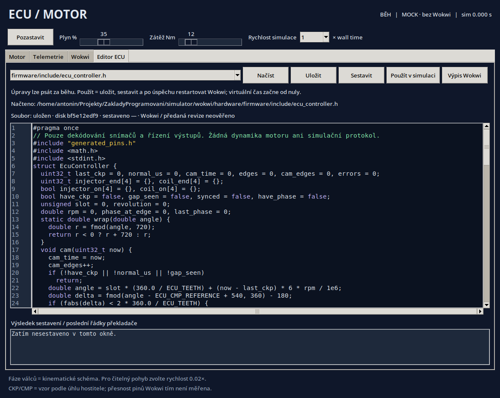
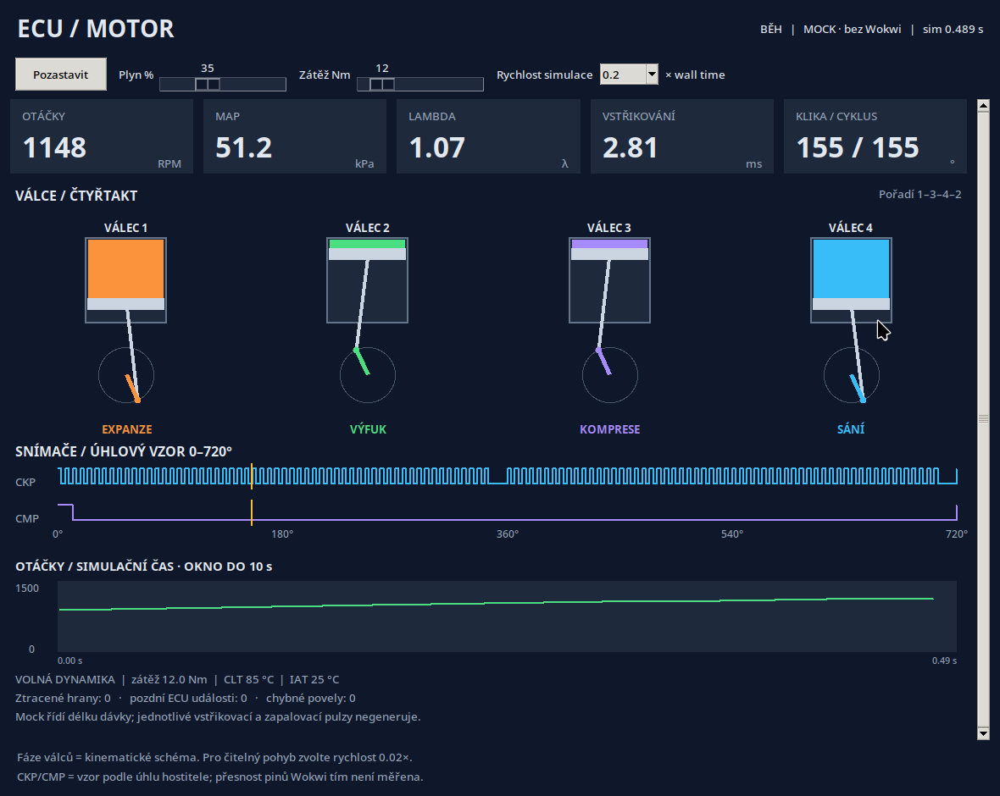
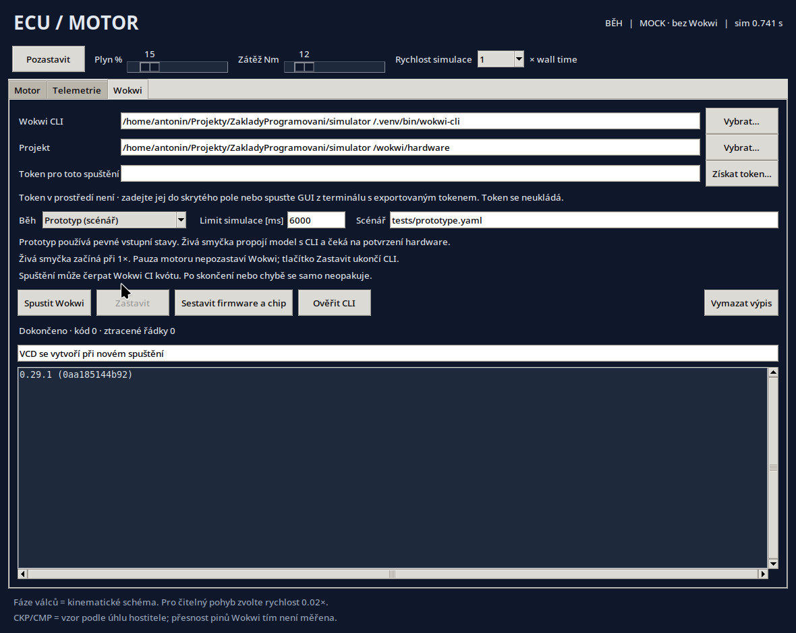
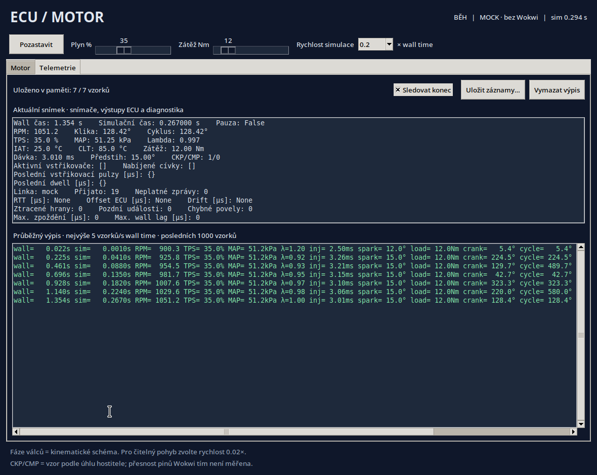
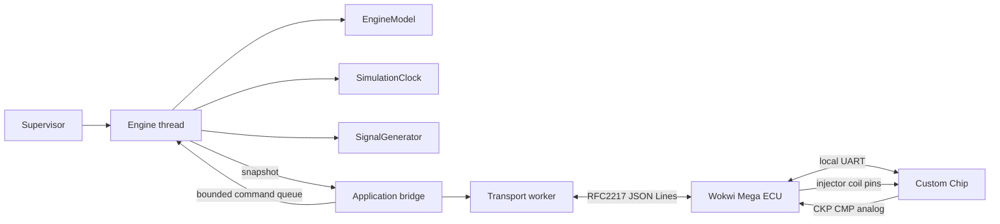
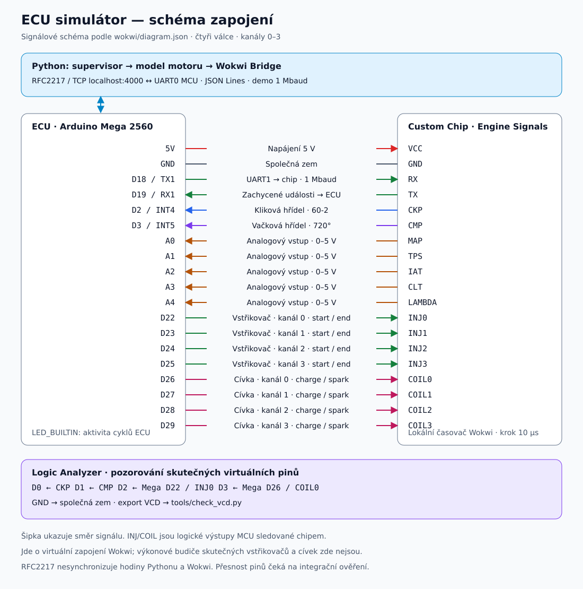

# ECU Simulator – druhá fáze

Výukový SIL čtyřtaktního motoru: Python model v samostatném vlákně,
virtuální čas, CKP/CMP, události ECU a obnovitelné RFC2217 spojení.
Výchozí motor má čtyři válce a CKP 60-2. Nejde o kalibrovaný model spalování.

**Stav:** Python testy, hostitelský test chipu, skutečný lokální RFC2217 test,
build firmware a WASM a Wokwi lint jsou ověřené. Běh uzavřené smyčky ve Wokwi
ani přesnost virtuálních pinů zatím ověřené nejsou: CLI nemá `WOKWI_CLI_TOKEN`.
Podrobnosti a postup přijetí jsou v [akceptaci](docs/acceptance.md).

## Linux: instalace a spuštění

Adresář se jmenuje `simulator` bez mezery na konci (původní `simulator ` byl přejmenován).
Z kořene repozitáře:

```bash
cd 'simulator'
python3 -m venv .venv
. .venv/bin/activate
python -m pip install -r requirements.txt
python main.py --mode mock --duration 10
python main.py --mode mock --rpm 1200 --load 20 --speed 0.5 --duration 10 \
  --telemetry /tmp/ecu-telemetry.jsonl
```

`--duration` je skutečná doba běhu; `--speed 0.5` posune virtuální čas přibližně
o polovinu. `--step-us 1000` určuje pevný virtuální krok (povoleno 1–100000 µs).
`--rpm` zapne stolici s pevně drženými otáčkami; bez něj otáčky vyplynou z momentu,
setrvačnosti a zatížení. `--load` je moment v Nm, `--throttle` rozsah 0–1.
`--config engine_config.json` nastavuje válce, setrvačnost, limity a geometrii snímačů.
Výpis ukazuje simulační čas, RPM, MAP, lambdu, stav linky a ztracené hrany.
`Ctrl+C` ukončí pracovní vlákna; nedostupný server nezastaví model.

## Mock používá stejnou ECU jako firmware

Python fyzikální model -> hrany CKP/CMP -> **EcuController v C++** -> vstřik/coil
pulzy -> Python model. Řadič zůstává v jediném zdrojovém souboru
`wokwi/hardware/firmware/include/ecu_controller.h`. Malý adaptér
`native/ecu_host.cpp` mu dodává vstupy a virtuální časovač (výchozí krok 25 µs).
Délky skutečně dokončených pulzů a naměřený předstih ovlivňují model motoru.

Při prvním spuštění se automaticky sestaví nativní knihovna do ignorovaného
`.cache/native-ecu/`; další spuštění použijí cache podle hashů zdroje a konfigurace.
Na Linuxu je potřeba C++ překladač (`sudo apt install g++`, případně `clang++`).
Hodnoty dávky/dwell/předstihu se načtou z `wokwi/hardware/config/engine.json`,
geometrie CKP/CMP a počet válců z aktivního Python modelu. Výchozí pořadí čtyřválce
je 1–3–4–2. Není zde druhá Python implementace řídicího algoritmu.

Demo ECU má zatím přímý převod pedál → palivo (0–3 ms), dwell 2 ms a pevný předstih.
Regulace požadovaných otáček zatím není implementovaná.
Otáčky při volné dynamice závisejí na plynu a zatížení. `--rpm 1000` zapne stolici.
`--rate` řídí jen četnost výpisů/GUI, nikoli činnost ECU. Pauza zastaví také lokální
ECU a `--speed` zpomalí model i ECU společně. CKP a CMP se pro ECU generují přímo,
bez závislosti na volitelné záznamové frontě hran.

Časy hran uvnitř integračního kroku jsou odhadem z předpovězeného pohybu kliky.
Model pak integruje stejný krok po jednotlivých výstupních událostech ECU. Menší
`--step-us` zpřesní vazbu při změnách RPM. Nativní běh ověřuje řídicí logiku;
nenapodobuje instrukce MCU, latence ISR, ADC ani časování virtuálních pinů Wokwi.
V telemetrii `bridge.controller` jsou revize, odhad RPM, synchronizace a počet událostí.

## Příprava studentského úkolu: regulace otáček

Pedál vstupuje do společného C++ řadiče jako `accelerator` (0–1). Funkce
`EcuController::update_control(now)` určuje `injection_us`; student bude měnit
právě ji. Zatím zůstává přímý převod `3000 * accelerator`. Pole `requested_rpm`
je připravené pro budoucí cíl a zobrazuje se v diagnostice, výchozí -1 znamená
nepoužito. Žádný regulátor cílových otáček se automaticky nezapíná.

Původní násobek pedálu byl přesunut z Python momentu do ECU dávky: například při
35 % je místo pevného 3ms vstřiku a násobku 0,35 skutečný 1,05ms vstřik. Výsledný
ustálený moment je stejný. Python už pedálem moment znovu nenásobí; studenti tak
mohou množství paliva určit i nezávisle na poloze pedálu. Odezva probíhá po pulzech
vstřiku a po krocích časovače (25 µs), nikoli okamžitým přepsáním otáček.

Mock předává pedál přímo při integraci. Firmware čte každých 10 ms kalibrovaný
ADC kanál TPS jako výukový vstup pedálu (referenční napětí virtuálního ADC 5 V).
Kalibrační krajní napětí se generují z TPS bodů JSONu; ADC kvantování může dávku
mírně odlišit od Mock. Výchozí držená dávka při startu je 0,875 ms, aby výchozí
moment před prvním dokončeným pulzem odpovídal dřívějšímu stavu.
MAP a lambda zůstávají orientační diagnostikou a nevstupují do řízení tohoto úkolu.

[Zadání pro studenta](docs/ukol_regulace_otacek.md) obsahuje postup zkoušení i
rozdíl mezi požadovanými otáčkami ECU a stolici `--rpm`. Úkol řešte bez `--rpm`.

## Editor ECU za běhu

Spusťte `python main.py --gui`. Samostatná záložka **Editor ECU** obsahuje C/C++
zdroje firmware, čísla řádků, zvýraznění syntaxe a výpis překladače.

- **Uložit** (Ctrl+S) uloží soubor; běžící ECU pokračuje se starým kódem.
- **Sestavit** přeloží uložené zdroje vedle běžící simulace.
- **Použít v simulaci** uloží, sestaví a po úspěchu obnoví aktivní backend od
  simulačního času nula. Plyn, zátěž a režim stolice se zachovají; otevřené pulzy se zruší.

V **Mock** režimu editor překládá společný `firmware/include/ecu_controller.h`
pomocí lokálního `g++` nebo `clang++`. Nepotřebuje Wokwi CLI, token ani PlatformIO.
Arduino `main.cpp` je adaptér pinů/časovačů desky; změny jeho obsluhy patří Wokwi,
zatímco změny rozhodování v `ecu_controller.h` se projeví v obou backendech.

V **Wokwi** režimu vyberte v jeho záložce projekt `wokwi/hardware`, CLI a token.
Překlad vyžaduje PlatformIO a projektový `scripts/build.py`; aplikování ukončí
starý Wokwi proces, spustí nový firmware a čeká na potvrzení komunikace.
Může čerpat CI kvótu. Legacy Mega projekt lze editovat, integrované sestavení
Wokwi je určené hardwarovému projektu s tímto build skriptem.

Při chybě překladu dosavadní simulace pokračuje. Změní-li se vstupy během překladu,
nová ECU se nepoužije. Editor rozlišuje neuložený obsah, uložené vstupy, sestavenou
a běžící/předanou revizi. Změnu souboru jiným editorem při ukládání odmítne.



Přehled oprav, propustnost UART a opakovatelné buildy popisuje
[technická poznámka](docs/review-fixes.md).

## Živá vizualizace motoru

Z adresáře `simulator` spusťte:

```bash
python main.py --gui --mode mock --speed 0.02
```



Okno ukazuje pohyb pístů a kliky, názorné fáze čtyřtaktu, RPM, MAP, lambdu,
délku dávky, úhel kliky a historii otáček v simulačním čase. Pro čtyřválec
zobrazuje pořadí 1–3–4–2; fáze jsou odvozené z úhlu, nikoli z modelu spalování.
CKP/CMP panel zobrazuje úhlový vzor a aktuální polohu hostitelského motoru.

Posuvníky mění plyn a zatížení přes frontu povelů. Tlačítko pozastaví hostitelský
motor a přepínač rychlosti umožní 1×, 0.2×, 0.05× nebo 0.02×. Zpomalení platí pro
skutečný simulační čas, ne pouze pro animaci. Pro viditelný pracovní cyklus použijte
0.02×; při 1× mohou pohyby kvůli obnovovací frekvenci obrazovky zdánlivě stát či couvat.
Režim `--rpm` drží otáčky pevně, takže při něm zátěž otáčky nezmění.

GUI se zavřením okna ukončí i pracovní vlákna. Bez `--duration` běží až do zavření;
`--gui --duration 30` je ukončí po 30 skutečných sekundách. Telemetrii lze stále
ukládat pomocí `--telemetry`. Pro menší obrazovky je obsah posuvný.

Pro spojení s Wokwi:

```bash
python main.py --gui --mode wokwi --baudrate 1000000
```

Pauza ani zpomalení hostitele neřídí hodiny MCU ve Wokwi. Okno ukazuje stav linky,
aktivní vstřikovače, nabíjené cívky a RTT. Mock nyní vytváří jednotlivé ECU pulzy
stejným C++ řadičem jako firmware. Krátký pulz může mezi dvěma
obnoveními okna proběhnout celý — měření patří časovým značkám a VCD.

GUI využívá standardní Tk. Pokud modul chybí, na Ubuntu/Debianu jej doinstalujte
příkazem `sudo apt install python3-tk` a spusťte program z desktopového terminálu
s dostupným displejem. Konzolový režim Tk nepotřebuje.

## Spuštění Wokwi přímo v GUI



```bash
cd 'simulator'
.venv/bin/python main.py --gui
```

V záložce **Wokwi** aplikace najde CLI v `.venv/bin` nebo `PATH`. Lze také vybrat
jiný soubor CLI a projekt s `wokwi.toml`. Výchozí projekt je izolovaný ESP32 profil
`wokwi/hardware`.

1. **Ověřit CLI** zobrazí verzi bez spuštění simulace.
2. **Sestavit firmware a chip** spustí projektový build; vyžaduje PlatformIO a Wokwi CLI.
3. Token se převezme z `WOKWI_CLI_TOKEN` procesu GUI. Pokud jste jej exportovali
   v terminálu, spusťte GUI ze stejného terminálu. Jinak jej lze zadat do skrytého
   pole pro tuto relaci okna; pro vyžádané restarty zůstává token pouze v paměti. **Získat token…** otevře oficiální Wokwi CI dashboard.
   Pole se po předání vymaže; token se neukládá a výpis jej maskuje.
4. Zvolte **Prototyp (scénář)** pro `tests/prototype.yaml` nebo **Živá smyčka motoru**
   pro propojení modelu a virtuální ECU, nastavte limit v milisekundách virtuálního
   času (výchozí 6000) a stiskněte **Spustit Wokwi**.
5. **Zastavit** ukončí vlastní CLI proces. Zavření GUI ukončí i jeho pracovní vlákna
   a podprocesy. Po skončení nebo chybě se simulace automaticky neopakuje.

CLI výpis a návratový kód jsou přímo v záložce. Každý běh dostane vlastní
`runs/wokwi-*/capture.vcd` uvnitř vybraného projektu; cesta je v okně. Předchozí
záznam se tím nepřepisuje. Výpis má omezenou historii 1000 řádků a sleduje ztráty.
Spuštění může čerpat Wokwi CI kvótu, proto vždy vyžaduje stisknutí tlačítka.

Živý režim používá dokumentovaný [wokwi-cli --interactive](https://docs.wokwi.com/wokwi-ci/cli-usage): stav motoru jde na stdin,
serial JSON z stdout do samostatné omezené fronty bridge. CLI diagnostika zůstává
ve výpisu. Nevyžaduje spuštění druhého RFC2217 serveru. Model začíná novým virtuálním
časem při rychlosti 1× a pokračuje až po platném potvrzení stejné hardware relace.
Po skončení CLI se vrátí do **pozastaveného Mock režimu**; tlačítkem **Pokračovat**
lze pokračovat bez Wokwi. Scénář používá vlastní pevné stavy a s modelem se nemíchá.

Pauza a změna rychlosti modelu nepozastaví hodiny Wokwi. Pro živou smyčku používejte
1× a případné přerušení řešte tlačítkem **Zastavit**. GUI integrace byla ověřena se
skutečnými lokálními testovacími procesy; potvrzení konkrétního ESP32/Custom Chip
projektu ve Wokwi stále vyžaduje [runtime ověření](wokwi/hardware/VERIFICATION.md).

## Výpisy telemetrie



V okně přepněte na záložku **Telemetrie**. Nahoře je aktuální snímek snímačů,
výstupů ECU a diagnostiky, dole průběžný textový výpis s wall i simulačním časem.
Zobrazuje RPM, TPS, MAP, teploty, lambdu, dávku a předstih, polohu kliky,
CKP/CMP, aktivní kanály, délky vstřikovacích pulzů a dwell, stav spojení,
RTT a diagnostické čítače. V Mock režimu mají údaje o hodinách ECU hodnotu `None`.

Výpis v okně pořizuje nejvýše 5 vzorků za skutečnou sekundu a uchovává posledních
1000 vzorků. V pauze je vidět neměnný simulační čas a pokračující wall time.
Přepínač **Sledovat konec** umožní pročítat starší řádky bez automatického posouvání.
Tlačítko **Uložit záznamy…** exportuje tento omezený archiv jako úplné JSON Lines
nebo čitelný `.txt` soubor. **Vymazat výpis** vymaže pouze paměťový archiv.

Pro souvislý záznam celého běhu použijte `--telemetry`; soubor se zapisuje průběžně
po každém vzorku bridge (výchozí `--rate 20`), i když není záložka otevřená.
Soubor se při spuštění vytvoří nebo přepíše. GUI ani vymazání jeho výpisu záznam
nepřeruší. Každý JSON řádek obsahuje `wall_elapsed_s`, `state` a `bridge`.

```bash
python main.py --gui --speed 0.02 --telemetry /tmp/ecu-beh.jsonl
# Současný čitelný výpis do terminálu i při otevřeném GUI:
python main.py --gui --console-telemetry --telemetry /tmp/ecu-beh.jsonl
# Samostatný konzolový běh vypisuje telemetrii automaticky:
python main.py --mode mock --duration 10 --telemetry /tmp/ecu-beh.jsonl
```

Vzorky nejsou záznamem všech hran GPIO: krátké ECU pulzy mohou proběhnout mezi
vzorky. Pro měření jednotlivých hran slouží časované události a Logic Analyzer/VCD.

## Komponenty



- `model.py`: čistý model momentu, setrvačnosti, zatížení a výstupů ECU.
- `clock.py`: celočíselný virtuální čas, bez fyziky a transportu.
- `signals.py`: neměnné hrany CKP/CMP interpolované z úhlové dráhy.
- `engine.py`: modelové vlákno, zamčené snímky, omezené fronty, časované povely.
- `protocol.py`: validace a omezené JSON Lines rámování.
- `transport.py`: nezávislé `open/read/write/close`, pracovní vlákno a reconnect.
- `bridge.py`: překlad aplikačních zpráv, Mock a měření RTT/offsetu hodin.
- `supervisor.py`: start, pause, resume, restart, close; žádný model spalování.
- `gui.py`, `visualization.py`: živý Tk pohled a oddělená geometrie klikového mechanismu.

Pro nový backend stačí implementovat transportní rozhraní a předat
`transport_factory` do `RFC2217Bridge`; model ani hodiny se nemění.

Programové řízení:

```python
from supervisor import Supervisor

app = Supervisor()
try:
    app.start()
    app.pause()
    app.engine.command({"load_nm": 20})
    app.resume()
    app.bridge.tick()
    print(app.engine.snapshot())
    app.restart()  # hostitelský model a jeho čas znovu od nuly
finally:
    app.close()
```

Po restartu hostitele restartujte i Wokwi firmware: transport neumí resetovat MCU.
Původní CLI `--mode mock/wokwi --url --duration --throttle --rate` zůstává zachováno;
`Engine.command()` je nyní fronta aplikovaná v následujícím kroku. Staré JSON povely
`{"type":"actuators",...}` nejsou na drátu přijímány: demo používá úplnou obálku v1.
Přímé programové `MockBridge.receive()` zachovává starý tvar kvůli původním experimentům.

## Schéma zapojení



[Otevřít diagram ve větší velikosti](docs/wiring.svg) ·
[Nativní zapojení pro Wokwi](wokwi/diagram.json)

Šipky označují směr signálů; čísla kanálů 0–3 odpovídají čtyřem válcům.
UART0 propojuje MCU s Pythonem a UART1 s Custom Chipem. Logic Analyzer
sleduje CKP, CMP, INJ0 a COIL0 pro export a kontrolu VCD.

## Wokwi Hardware – izolovaná ESP32 ECU

Nové zadání virtuálního hardware je v **[wokwi/hardware/README.md](wokwi/hardware/README.md)**.
Tento samostatný profil používá GPIO/ADC firmware ESP32 bez simulačního protokolu,
konfigurovatelný Custom Chip s událostním CKP/CMP a oddělený UART adaptér.
Preferuje buffered režim a přidává CRC32, relace a diagnostiku virtuálního hardware.

```bash
python wokwi/hardware/scripts/build.py
# Ve Wokwi vyberte wokwi/hardware/wokwi.toml; poté:
python wokwi/hardware/scripts/run_host.py --gui --telemetry /tmp/ecu-hardware.jsonl
```

Sestavení a nativní integrační testy jsou ověřené. Přímé propojení Serial Monitoru
s UART chipu i skutečný běh Wokwi zůstávají otevřené: viz [prototyp a výsledky](wokwi/hardware/VERIFICATION.md).
Následující Mega demo je historický profil, který neodděluje protokol od ECU.

Rozšířené schéma odděluje snímače, vstupní obvody, MCU a drivery osmi zátěží.
Má přepínač hlavního relé a LED indikaci; [popis schématu a měřicích bodů](wokwi/hardware/README.md#schéma-blíže-skutečné-ecu).

## Historický Wokwi demonstrační projekt (Mega)

Používá Arduino Mega 2560 kvůli samostatnému UART pro hostitele a chip.
Zdroj i zapojení jsou v `wokwi/`; vestavěná LED bliká při cyklech výstupů ECU.

```bash
# Z adresáře simulator:
python -m pip install platformio
pio run -d wokwi
cd wokwi
# Oficiální wokwi-cli musí být v PATH:
wokwi-cli chip compile engine-signals.chip.c -o engine-signals.chip.wasm
wokwi-cli lint .
cd ..
```

Ve VS Code/VSCodium vyberte `wokwi/wokwi.toml` příkazem **Wokwi: Select Config File**,
pak **Wokwi: Start Simulator**. Panel simulace ponechte viditelný.
Poté v druhém terminálu, z adresáře `simulator`:

```bash
python main.py --mode wokwi --url rfc2217://localhost:4000 --baudrate 1000000 \
  --throttle 0.35 --duration 30 --telemetry /tmp/ecu-wokwi.jsonl
```

Výchozí baudrate Pythonu zůstává 115200 pro původní projekty. Historické Mega demo a jeho lokální
UART chipu používají **1000000 baud**. Doporučený demonstrační rozsah je 300–2000 RPM;
při vyšších otáčkách není průchodnost všech JSON událostí garantovaná. Sledujte
ztráty a `CAPTURE_OVERFLOW` v Chips Console. Firmware při nepřijetí stavu po 1 s
přestane zahajovat nové impulzy a zastaví lokální snímače; již otevřené impulzy dokončí.

Chip generuje 60-2/CMP v čase Wokwi a převádí MAP/TPS/IAT/CLT/lambdu na analogové piny.
Piny ECU zachycuje přes `pin_watch`, značkuje `get_sim_nanos()` a posílá přes UART
zpět firmwaru, který tvoří `ecu_event`. Jeho řadič používá RPM telemetrii pro jednoduchou
regulaci paliva. Čte počty CKP/CMP, ale zatím nejde o plnohodnotnou zubově řízenou ECU.

**Lokální chip není deterministickým přehrávačem Python hran.** Vlastní úhel integruje
z poslední hodnoty RPM; fáze motoru na hostiteli a MCU se může rozcházet.
Pythonové `--speed` neřídí rychlost Wokwi. Časové domény popisuje
[dokument synchronizace](docs/timing.md). Samotný úspěšný přenos JSON nesplňuje
akceptaci přesných pinů.

## Automatické ověření

Z adresáře `simulator`:

```bash
PYTHONDONTWRITEBYTECODE=1 python -m unittest discover -s tests -v
# Navíc skutečný TCP server jen na loopbacku; potřebuje oprávnění otevřít socket:
ECU_TEST_TCP=1 PYTHONDONTWRITEBYTECODE=1 python -m unittest discover -s tests -v
# Navíc skutečné GUI testy na dostupném displeji:
ECU_TEST_GUI=1 PYTHONDONTWRITEBYTECODE=1 python -m unittest discover -s tests -v
# Hostitelský C test skutečného zdroje chipu s náhradami Wokwi API:
clang -std=c11 -Wall -Wextra -Werror -Wno-unknown-attributes -Wno-unused-function \
  -I wokwi tests/chip_host_test.c -lm -o /tmp/ecu-chip-test
/tmp/ecu-chip-test
```

Časovací testy používají virtuální kroky; čekání s timeoutem je pouze v testech
životního cyklu a I/O. C test nenahrazuje běh WebAssembly ve Wokwi.

## Další dokumentace

- [Protokol a model ECU](docs/protocol.md)
- [Časování, bezpečnost vláken a omezení](docs/timing.md)
- [Evidence a integrační akceptace](docs/acceptance.md)

Oficiální podklady: [RFC2217 konfigurace](https://docs.wokwi.com/vscode/project-config),
[Time API](https://docs.wokwi.com/chips-api/time),
[GPIO](https://docs.wokwi.com/chips-api/gpio), [UART](https://docs.wokwi.com/chips-api/uart),
[analogové API](https://docs.wokwi.com/chips-api/analog),
[sestavení WASM](https://docs.wokwi.com/guides/custom-chips-to-wasm).
Dodané `wokwi-api.h` pochází z https://wokwi.com/api/chips/wokwi-api.h (14. 11. 2026).
