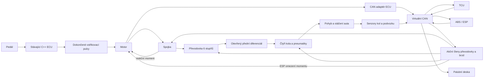

# Motor → celé auto: první funkční etapa

Model rozšiřuje stávající motor o přední pohon, automatickou převodovku s TCU,
spojku, otevřený diferenciál, čtyři kola, brzdy s ABS, jednoduché ESP,
virtuální CAN a palubní přístroje. Dosavadní samostatný režim motoru zůstává dostupný.
Studentův C++ regulátor v `ecu_controller.h` se používá dál beze změny.

## Spuštění a ovládání

Ve společném spouštěči vyber projekt **ECU simulátor** a akci
**Spustit simulaci auta s palubní deskou**. Nebo z kořene repozitáře:

```bash
simulator/.venv/bin/python simulator/main.py --mode mock --gui --vehicle
# Konzolová jízda:
simulator/.venv/bin/python simulator/main.py --vehicle --selector D --throttle 0.7 --duration 10
# Reprodukovatelný scénář v čistě virtuálním čase, bez GUI a čekání:
simulator/.venv/bin/python simulator/vehicle_demo.py --output /tmp/jizda.jsonl
```

V záložce **Auto / palubní deska**:

1. Zapni model auta, pokud běží jen motor. Zvol `D` a přidej pedál nahoře.
2. Sleduj rychlost, otáčky, převod a senzory. TCU řadí podle otáček motoru.
3. Posuvníkem **Brzda %** ovládáš požadavek brzdění.
4. **Volant °** zadává přímo úhel předních kol (bez převodu volantu).
5. **μ vlevo/vpravo** mění přilnavost na každé straně. Například 0,85 je
   výukový suchý povrch, 0,15 velmi kluzký. Tyto hodnoty nejsou měřením vozovky.
6. Přepínači ABS a ESP porovnej stejné podmínky se zásahem a bez zásahu.
7. Odpoj CAN a po 300 ms virtuálního času sleduj chybu komunikace a pomlčky
   místo zastaralých údajů. Po obnovení se zprávy opět přijímají.

`N` rozpojí pohon, `R` dovolí couvání až po zpomalení jízdy vpřed pod 0,5 m/s.
Při přechodu z couvání do `D` platí stejná mez. `P` rozpojí pohon a při téměř
nulové rychlosti přidrží kola; neimplementuje mechanickou západku převodovky.
Rychlost v přístrojích je absolutní, směr ukazuje `R`; telemetrie má rychlost se znaménkem.
Brzdění nepřepisuje pedál plynu: při současném plynu a brzdě motor stále vytváří moment.
Pro test regulace nepřidávej `--rpm`, protože by stolice držela otáčky přímo.

Volby CLI `--brake 0.5`, `--steer 15`, `--road-mu 0.2` nastaví počáteční stav
režimu `--vehicle`. Levý a pravý povrch lze zvlášť měnit v GUI nebo přes
`engine.vehicle_command({"mu_left": 0.15, "mu_right": 0.85})`.
`--load` zůstává dodatečnou zátěží motoru, nad ni se přičítá zátěž převodovky.
Pauza a rychlost simulace platí i pro podvozek a CAN. Reset začne znovu v neutrálu,
s nulovou rychlostí, výchozím povrchem a prázdnou historií CAN. Použití nové ECU
rovněž resetuje auto. Vypnutí modelu auta odstraní jeho momentové zatížení motoru.

## Schéma vozu a symbol na přístrojích

Záložka **Schéma motoru / vozu** má dva podpanely: **Celý vůz** a původní
**Řez motoru**. Ve voze je příď nahoře; FL/FR jsou přední levé/pravé kolo,
RL/RR zadní levé/pravé. Modře je zakreslen přenos momentu přes spojku,
převodovku a přední diferenciál; fialově čárkovaně CAN propojení ECU, TCU,
ABS/ESP, snímačů a přístrojů. Kliknutím na díl zobrazíš jeho význam a aktuální
hodnoty modelu. Schéma lze přiblížit a uložit jako samostatné průhledné SVG.
Barvy kol ukazují běžný stav, brzdění či skluz, ABS/ESP a převodovka zvýrazňují zásah/řazení.

Pod rychloměrem a otáčkoměrem je menší **symbolický vůz** se čtyřmi koly,
rychlostmi a tlaky brzd. Přední kola se natáčejí podle doručeného úhlu řízení.
Tento pohled stejně jako přístroje používá doručené CAN hodnoty: po timeoutu
zešedne a místo čísel ukáže pomlčky. Podrobné schéma naopak vysvětluje přímo
stav modelu, i když komunikace vypadla. Obrys a rozmístění dílů jsou výukové,
nikoli konstrukční výkres. Při vypnutém modelu auta jsou popisy schématu
výslovně označené jako ilustrační.

Zdrojové SVG je v `assets/vehicle-overview.svg`, společné vykreslení a živé
popisy v `vehicle_diagram.py`. Řez motoru se nadále čte z původního SVG.

## Co je propojeno



`EngineModel` počítá motor. `VehicleModel` počítá podvozek jednou za motorový
makrokrok a vnitřně jej dělí nejvýše po 1 ms. Predikce kliky pro ECU proto
neintegruje auto podruhé. Spojka přenáší moment podle rozdílu otáček s omezením
±150 Nm; převody a stálý převod 3,9 mění moment i otáčky. Při řazení se na 180 ms
rozepne spojka. V nízkých otáčkách se částečně uvolňuje, aby model nezhasínal při zastavení.
Otevřený diferenciál rozděluje stejný hnací moment mezi přední kola, nikoli stejné
otáčky: na nestejném povrchu může jedno kolo prokluzovat více.

Pneumatiky mají nasycenou křivku podélné síly podle rozdílu rychlosti běhounu
a vozovky. Každé kolo má vlastní setrvačnost a brzdový moment. Auto překonává
valivý a aerodynamický odpor; příkaz `grade_pct` dovoluje zadat zjednodušené stoupání.

ABS při skluzu nad 18 % a rychlosti nad 1 m/s snižuje tlak daného kola a potom
jej znovu postupně zvyšuje. ESP porovnává požadované stáčení z úhlu kol a rychlosti
se simulovaným stáčením, přibrzďuje jedno zadní kolo a žádá snížení momentu na 45 %.
Je to demonstrace zpětné vazby, nikoli reprodukce výrobního algoritmu ABS/ESP.
CAN není vložena mezi původní CKP/CMP a vstřikovací časovače: jejich časování zůstává lokální.

## Senzory

Stávající CKP, CMP, TPS/pedál, MAP a orientační lambda zůstávají dostupné.
Podvozek doplňuje:

| Oblast | Veličiny a jednotky | Způsob simulace |
| --- | --- | --- |
| Kola | FL, FR, RL, RR [km/h] | vlastní úhlová rychlost každého kola |
| Jízda | rychlost [km/h], podélné/příčné zrychlení [m/s²] | pohybový model |
| ESP | úhel předních kol [°], stáčení [°/s] | vstup řízení a jednoduchá dynamika stáčení |
| Brzdy | tlak každého kola [bar] | normalizovaný povel × 100 bar |
| Převodovka | vstupní/výstupní otáčky [ot/min] | motor, kola a stálý převod |
| Teploty | kapalina, olej [°C] | pomalý náběh k provozní teplotě |
| Mazání | tlak oleje [kPa] | omezený odhad z otáček |
| Elektrika | napětí sítě [V] | 12,3 V / 14,2 V podle chodu motoru |
| Palivo | stav nádrže [l], tlak lišty [kPa] | odhad spotřeby z dávky/cyklů, pevný provozní tlak |
| Vzduch/výfuk | MAF [g/s], IAT [°C], barometrický tlak [kPa], EGT [°C] | orientační vztahy a konstanty |

Odhad MAF není model skutečného plnění válců. Nádrž je zatím ukazatel spotřeby,
neodstavuje vstřikování při vyprázdnění. Olejový tlak ani napětí nejsou výsledkem
hydraulického či elektrického obvodu. Nové senzory zatím nevstupují do studentského
regulátoru paliva; jejich čtení lze doplnit v další etapě. Dynamická kapalina v režimu
auta se promítá také do původních polí `coolant_c`/`clt_c` motorové telemetrie.

## CAN zprávy

Vlastní výukový protokol v `can_bus.py`, standardní 11bit ID, maximálně 8 B,
little endian, 500 kbit/s. Nižší ID vyhrává při současně čekajících zprávách;
rozpracovaný rámec se nepřerušuje. Doba přenosu je odhad `(67 + 10 × počet bajtů)`
bitů, ne bitově přesná simulace stuffingu, CRC, ACK nebo fyzické vrstvy.

| ID | Odesílatel | Formát `struct` | Pole |
| --- | --- | --- | --- |
| 0x100 | adaptér ECU | `<HHhH` | rpm, dávka µs, moment Nm, pedál ‰ |
| 0x110 | snímače kol | `<hhhh` | FL/FR/RL/RR v cm/s |
| 0x120 | snímače podvozku | `<hhhh` | rychlost cm/s, stáčení mrad/s, úhel mrad, brzda ‰ |
| 0x130 | volič | `<B` | P=0, R=1, N=2, D=3 |
| 0x200 | TCU | `<bB` | převod -1 až 6, příznak řazení |
| 0x210 | ABS/ESP | `<BBBBBBBB` | 4 tlaky 0–255, ABS, ESP, limit momentu %, chyba |
| 0x300 | teploty/síť | `<hhHH` | kapalina/olej 0,1 °C, tlak oleje kPa, napětí 0,01 V |
| 0x310 | ostatní senzory | `<HHhh` | palivo ‰, MAF 0,1 g/s, podélné/příčné zrychlení cm/s² |

Řídicí a publikační cyklus je 10 ms virtuálního času. Přijímače mají timeout 300 ms.
TCU i ABS/ESP používají doručené snímky ze sběrnice. Při timeoutu se pohon odpojí,
základní brzda dál reaguje přímo na pedál a ABS/ESP se vypne. Po obnově CAN
se řízení zotaví po doručení čerstvých vzorků. Fronta má 256 rámců; historie 120,
GUI ukazuje posledních 50. Přetečení a odpojení zvyšují počet zahozených zpráv.
Palubní deska zobrazuje výhradně dekódované doručené zprávy, nikoli přímé interní hodnoty.

Adaptér publikuje stav současné ECU na CAN; C++ firmware zatím nemá CAN ovladač.
TCU/ABS/ESP jsou Python řídicí jednotky. Virtuální CAN není připojena k Wokwi ani
k fyzickému autu. Při Wokwi backendu zůstává podvozek na hostiteli; jeho lokální
historie se neposílá do UART, aby nepřetížila původní protokol. Reálný Wokwi běh
nového režimu není ověřen.

## Telemetrie, zdroje a ověření

V `state.vehicle` jsou podvozek, `sensors`, `dashboard` a `can` včetně rámců.
Textový výpis přidává `CAR`, převod, ABS/ESP a počty CAN zpráv. Export GUI i
`--telemetry` ukládá kompletní snímek. Implementace je rozdělená:

- `vehicle.py`: pohon, kola, TCU, ABS/ESP a senzory;
- `can_bus.py`: rámce, přenos a datový protokol;
- `vehicle_gui.py`: palubní deska a monitor CAN;
- `vehicle_demo.py`: opakovatelný integrační scénář;
- `tests/test_vehicle.py`: testy fyzikálních vazeb, CAN, řadičů, času a CLI.

```bash
cd simulator
.venv/bin/python -m unittest discover -s tests -p test_vehicle.py -v
# Skutečný GUI test vyžaduje dostupný displej:
ECU_TEST_GUI=1 .venv/bin/python -m unittest discover -s tests -p test_vehicle.py -v
```

Lokálně ověřeno: rozjezd se současnou C++ ECU, automatické řazení, stejné momenty
otevřeného diferenciálu při rozdílném prokluzu, ABS na kluzku, selektivní brzdění ESP,
ztráta a obnova CAN, pauza/reset a JSONL export. Grafický test je připraven, ale
v tomto prostředí nebyl dostupný displej, proto vizuální ovládání není potvrzené.
Šest starších testů předpokládá původní lineární dávku z pedálu a s již upraveným
studentským regulátorem selhává i bez této změny; regulátor nebyl přepisován.

## Jízda po okruhu

Na tento model nyní navazuje [režim jízdy s joypadem](jizda.md): poloha vozu,
uzavřený okruh, změna povrchu, měření kol a nastavení ovladače.

## Další navazující etapy

Tato etapa propojuje všechny požadované části do funkčního výukového celku.
Pro podrobnější simulaci celého auta zbývá postupně doplnit:

1. **Dynamiku podvozku:** boční skluz, přenos zatížení, zatáčení všech kol,
   kombinovanou přilnavost, polohu auta v mapě a zavěšení. Dnešní stáčení je jen
   omezený jednostopý vztah doplněný momentem od rozdílu podélných sil.
2. **Pohon:** detailní spojku/měnič, mapy účinnosti, teplotu převodovky,
   diferenciál s omezenou svorností a volbu poháněné nápravy.
3. **Senzory a závady:** šum, výpadky, zkraty, nesouhlas snímačů, DTC a diagnostiku.
4. **Síť:** DBC import, gateway, oddělené segmenty, arbitrační konflikty,
   CAN chyby/bus-off a volitelné SocketCAN rozhraní.
5. **Řídicí jednotky:** samostatné studentské TCU/ABS/ESP projekty a skutečný
   CAN adaptér pro MCU; následně společné ověření ve Wokwi či na stolici.
6. **Karoserii a energetiku:** světla, směrovky, dveře, HVAC, startér,
   alternátor, baterii a tepelný model. Nynější kontrolky jsou jen základ přístrojů.
