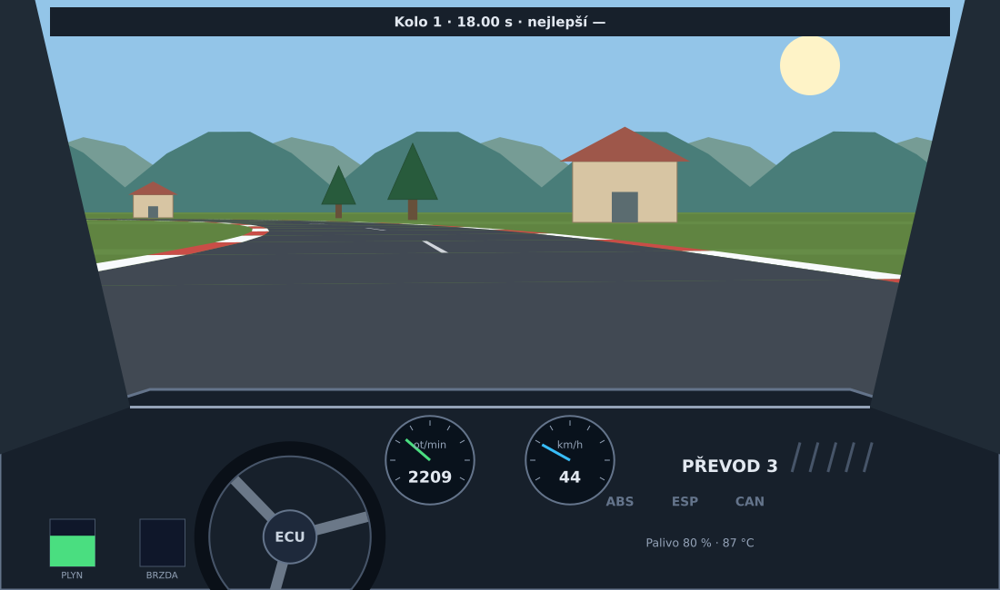

# Jízda po okruhu s joypadem

Režim **Jízda / okruh** používá tentýž motor, C++ ECU, převodovku, diferenciál,
kola a ABS/ESP jako simulátor auta. Pohled z kokpitu a přepínatelná mapa přidávají polohu a směr vozu na
uzavřeném okruhu dlouhém přibližně 1,50 km, měření kol a změnu povrchu mimo asfalt.
Pohled z čelního okna je lehké perspektivní 2,5D vykreslení rovinné tratě;
nevytváří další fyzikální model pohybu.

## Spuštění

Ve společném spouštěči vyber **ECU simulátor → Spustit jízdu po okruhu
(joypad / klávesnice)**. Nebo z kořene repozitáře:

```bash
simulator/.venv/bin/python simulator/main.py --mode mock --gui --drive --rate 60
# Vlastní zařízení (automatické rozpoznání rozložení):
simulator/.venv/bin/python simulator/main.py --gui --drive --rate 60 \
  --joypad /dev/input/js0
```

Jízda začíná pozastavená, v `D`, se zabrzděným autem a nulovým pedálem.
Zvol **Joypad** nebo **Klávesnice**, klikni do okruhu a stiskni **Pokračovat**.
Tlačítko **Zapnout jízdu / návrat na start** umožňuje přejít do režimu i z
běžného motorového GUI; přemístí auto na start, ale nemění zdroj regulátoru.
Klávesa R resetuje celý model včetně motoru, času a měřených kol.

`--drive` zapíná model okruhu, `--gui` jeho zobrazení. Bez GUI lze stav číst
přes původní telemetrii; bez programového vstupu jízda zůstává pozastavená.
Pevné otáčky `--rpm` se s `--drive` odmítají. Výchozí přídavná motorová zátěž
`--load 12` zůstává zachovaná; na ni navazuje zátěž skutečného pohonu.

## Výhled z čelního okna a krajina

Výchozí pohled **Z čelního okna** zobrazuje perspektivní vozovku, obrubníky,
trávu, stromy, drobné budovy a vzdálené kopce. Trať je promítnuta ze stejných
souřadnic, na kterých se pohybuje skutečný model auta; zatáčení tedy mění výhled.
Stromy a domky mají pevná místa vedle okruhu, ale zatím nemají kolize. Kopce
jsou dekorace na horizontu, silnice je rovinná.

V záběru je čelní sklo s A-sloupky, volant a palubní deska. Volant se otáčí
podle úhlu předních kol s ilustračním převodem 14:1. Otáčkoměr, rychloměr,
převod, ABS/ESP, CAN, palivo a teplota používají současná data palubní desky.
Dva malé sloupce ukazují skutečný požadavek plynu a brzdy, aby šlo ověřit
mapování joypadu. Při chybějících CAN údajích jsou v přístrojích pomlčky.

Přepínačem pohledu v horní liště zvolíš **Mapa okruhu** pro původní pohled
shora. Volba **Kamera za vozem** přibližuje mapu k autu; pohled čelním sklem
se automaticky pohybuje a otáčí s autem. Oba pohledy používají stejné ovládání.



Náhled vznikl ze stejných vykreslovacích příkazů po 18 s simulované jízdy;
nejde o potvrzení interaktivního GUI na fyzickém displeji. Renderer je v
`cockpit.py` a nepotřebuje OpenGL ani nové runtime balíčky.

## Joypad na Linuxu

Čtečka používá standardní neblokující rozhraní Linux **joydev**
(`/dev/input/js0`, `/dev/input/js1`, …), bez dalších Python balíčků.
Podkladem je [programovací rozhraní v dokumentaci Linux kernelu](https://docs.kernel.org/input/joydev/joystick-api.html).
Jde o starší rozhraní `js`, nikoli evdev/SDL; zařízení musí být v systému
viditelné a čitelné touto cestou. Ovládání joypadem pro Windows/macOS tato etapa
neobsahuje. Klávesnice nemá závislost na joydev.

Po připojení USB/Bluetooth ovladače vyber cestu a stiskni **Připojit / obnovit**.
Nad okruhem sleduj čísla a hodnoty os i stisknutá tlačítka. Čísla začínají nulou.
Pokud zařízení chybí nebo přístup systém odmítne, aplikace zobrazí konkrétní chybu;
vyřeš nejprve připojení/přístup v OS nebo vyber klávesnici. Aplikace oprávnění nemění.

### Automatické rozpoznání Xbox-like / PS4 / D-input

Po připojení aplikace načte skutečné významy os a tlačítek z Linux driveru
(`JSIOCGAXMAP` / `JSIOCGBTNMAP`). Princip vychází z popisu `EvdevGamepad` ve
Federated Workspace (`docs/gamepad-demo-presenter.md`, oddíl 3.2): významy
ABS/BTN se oddělují od pořadových čísel konkrétního ovladače. Nepřebíráme
prezentační akce ani emulaci myši; zachováváme vlastní joydev transport.

- Xbox-like se samostatným pravým stickem: levý stick řídí, Z/RZ jsou brzda/plyn.
- PS4 / DualShock: stejné významy, ale jiné pořadí os se zjistí z driveru;
  nepředpokládá se univerzální kombinace čísel 0/5/2.
- D-input zařízení s pravým stickem na Z/RZ: tyto osy se nepoužijí jako
  triggery. Pokud existují digitální L2/R2, ovládají brzdu/plyn. Jinak se
  nabídne levá páčka Y (nahoru plyn, dolů brzda) a popis to výslovně uvede.
- Neznámá tlačítka či rozložení vyžadují ruční profil; aplikace nevydává odhad
  za rozpoznané rozložení konkrétního modelu.

Přepočtené **PLYN / BRZDA / ŘÍZENÍ** se zobrazují pod živými osami. Vedle
čísel os jsou jejich významy ABS a nad nimi název zařízení. Před pokračováním
uvolni oba pedály a vystřeď páčku. Mrtvá zóna pedálů potlačuje drobný klidový šum.
Tlačítko **Rozpoznat ovladač** znovu zapne automatické mapování. Načtení
vlastního profilu přes `--joypad-config cesta.json` nebo použití editoru
naopak zachová explicitní ruční nastavení; změny se samy nepřepisují.

`config/joypad-default.json` zůstává příkladem staršího ručního Xbox-like
mapování. Není univerzálním profilem Rapture ani PS4. U různých režimů téhož
ovladače rozhodují skutečné údaje driveru, nikoli pouze obchodní název.

**Uložit diagnostiku…** vytvoří JSON s názvem zařízení, mapou ABS/BTN,
aktuálními hodnotami, použitým profilem a přepočtenými pedály. Pokud některý
ovladač nereaguje správně, tento záznam dovolí odlišit nerozpoznaný layout,
chybějící události a nevhodnou kalibraci.

Před pokračováním musí zařízení nahlásit všechny tři mapované osy.
Nenahlášený pedál znamená nulu, nikdy půl plynu. Inicializační události tlačítek
nespouštějí reset ani pokračování. Ovladač se při stisku akce vyhodnocuje podle
hrany stisku, nikoli opakovaně v každém snímku.

### Sekvence ověření páček a tlačítek

Tlačítko **Ověřit páčky a tlačítka…** otevře průvodce nad abstrakcí ovladače:
levá/pravá páčka, kříž, čelní tlačítka, dvě jednosměrné páky a dva horní triggery.
Jízdní profil se tím nemění a žádná tlačítka během průvodce neřadí ani neresetují auto.

1. Připoj zvolený ovladač. Uvolni všechny jeho prvky a stiskni **Zahájit**.
2. Levou páčkou projeď zvlášť vlevo, vpravo, nahoru a dolů; totéž pravou páčkou.
3. Ověř čtyři směry kříže a čtyři čelní tlačítka podle pokynů.
4. Ověř levou a pravou jednosměrnou páku (L2/LT a R2/RT), poté dva horní
   triggery/tlačítka (L1/LB a R1/RB).

Celkem je 20 kroků. Po každém vstupu vrať všechny prvky do klidu; průvodce čeká
na stabilní návrat nejméně 250 ms. Nesprávná páčka, směr nebo více současných
vstupů krok nepotvrdí. **Nefunguje** zaznamená chybu, **Přeskočit** ponechá krok
jako neověřený. Nedostupný prvek se nezaměňuje s nulovou hodnotou.

Tabulka ukazuje pojmenované hodnoty; fyzická osa/tlačítko a kód ABS/BTN jsou pouze
diagnostickým detailem. Podporuje kříž hlášený osami i tlačítky a digitální variantu
jednosměrných pák. Názvy vycházejí z [Linux gamepad abstrakce](https://docs.kernel.org/input/gamepad.html).
Starší driver s odlišnou sémantikou se při ověření může projevit jako nesprávný prvek;
průvodce toto nepřepisuje automatickým odhadem.

**Uložit protokol…** uloží JSON se stavem každého kroku, klidovými hodnotami a
vazbami. Po odpojení zařízení se ověření zastaví, částečný protokol lze uložit.
Po připojení začni nové ověřování. Ověření neskenuje jiná zařízení ani automaticky
nemění mapování používané jízdou.

### Nastavení a kalibrace

**Mapování os a tlačítek…** otevře JSON profil. Dialog umožňuje načíst,
upravit, použít a uložit profil pod zvolenou cestou. Změny nastavení jízdu
pozastaví. Rozpoznání čísel os sleduj v živém výpisu pod tlačítky.

- `steer_axis`, `throttle_axis`, `brake_axis`: čísla os.
- `steer_invert`, `throttle_invert`, `brake_invert`: obrácení směru (`true/false`).
- `throttle_mode` a `brake_mode`: `trigger` převádí celý rozsah −1…+1 na 0…1;
  `positive` používá kladnou polovinu páčky, `negative` zápornou.
- Pro jedinou společnou osu pedálů zadej stejné číslo oběma a režimy
  `negative` pro plyn, `positive` pro brzdu, případně opačně podle zařízení.
- `deadzone`: mrtvá zóna řízení/páčky (výchozí 0,08).
- `pedal_deadzone`: mrtvá zóna samostatných spouští (výchozí 0,04).
- `throttle_button`, `brake_button`: volitelná čísla digitálních pedálových
  tlačítek; `null` znamená použít osu.
- `sensitivity`: exponent řízení (výchozí 1,6); vyšší hodnota zjemní střed.
- `*_button`: čísla jednotlivých akčních tlačítek; musí být různá.

Při uvolněných spouštích ověř nulový plyn i brzdu. Plný rejd odpovídá úhlu
předních kol 30°, nikoli úhlu věnce volantu. Ve vysoké rychlosti je nutný malý
rejd; prudké zatočení může vyvolat ESP a vyjetí z tratě.

## Klávesnice a ztráta vstupu

Klikni do plochy okruhu, aby dostala klávesové zaměření:

| Klávesy | Akce |
| --- | --- |
| ↑ / W | plyn |
| ↓ / S / mezerník | brzda |
| ← / A, → / D | řízení s postupným náběhem a návratem |
| Enter / P | pauza / pokračování |
| R | reset motoru, polohy, času a kol |
| E / Q / N | D / R / neutrál |

Přepnutí mimo záložku okruhu nebo ztráta zaměření okna pozastaví jízdu.
U klávesnice ji pozastaví také ztráta zaměření plochy okruhu, aby nezůstal
zapamatovaný plyn po uvolnění klávesy v jiném prvku.
Odpojení joypadu vynuluje uložené vstupy, ubere plyn, nastaví brzdu a pozastaví
fyziku. Po opětovném připojení musíš pokračování potvrdit. Kromě toho pracovní
vlákno hlídá obnovení řídicího vstupu nejpozději za 0,5 s **simulačního** času;
při chybě či zamrznutí GUI se jízda sama pozastaví. Normální klidový ovladač
nepotřebuje generovat změny: GUI obnovuje jeho poslední platný stav.

## Okruh, fyzika a časování

Asfalt má výukovou přilnavost μ=0,85; mimo asfalt μ=0,28 a dodatečný odpor 600 N.
Přilnavost každé strany přední nápravy se určuje podle polohy kol, takže na hraně
vozovky může vzniknout rozdíl mezi stranami. Zatím se stejný povrch přiřazuje
přednímu i zadnímu kolu dané strany. Okraj není pevná bariéra: auto může vyjet
na trávu a vrátit se. Okolí ani ostatní auta nemají kolizní model.

Poloha se integruje z podélné rychlosti a modelovaného stáčení ve stejném kroku
jako auto. Nezávisí na četnosti vykreslení. Kladné stáčení je vlevo; světové y
roste nahoru. V režimu mapy pohled **Kamera za vozem** posune a přiblíží kameru k autu, ale
zachová orientaci mapy (nejde o pohled z kokpitu). Bez přepínače vidíš celý okruh.

Nové kolo se započítá jen po postupném průjezdu třemi kontrolními čtvrtinami
okruhu a startem správným směrem. Vyjetí mimo trať zneplatní aktuální kolo;
na příštím průjezdu startem začne nové. Couvání přes čáru ani zkratka proto
nevytvářejí další platná kola. Aktuální a nejlepší čas jsou v HUD, poslední čas
je navíc v telemetrii `driving.last_lap_s`. Pauza čas kola neposouvá.

Motor stále řídí aktuální studentský algoritmus. Pokud pedál znamená cílové
otáčky, bude auto reagovat právě podle něj. Režim jízdy jej nepřepisuje na
přímé ovládání momentu. ABS/ESP i řazení mají dosavadní výukové zjednodušení,
boční skluz, přenos zatížení, pneumatiky a aerodynamika nejsou kalibrované.

## Zdroj a ověření

- `racetrack.py`: geometrie okruhu, poloha, povrch a měření kol;
- `joypad.py`: vstup joydev, dekódování a mapování;
- `driving_gui.py`: mapa, přepínání pohledů, klávesnice a nastavení ovladače;
- `cockpit.py`: perspektiva vozovky, krajina, volant a palubní přístroje;
- `engine.py`: společný krok, řídicí vstup a hlídání jeho dostupnosti;
- `tests/test_driving.py`: geometrie, kola, ovladač bez hardware a vazba na C++ ECU.

V exportu `--telemetry` je vedle motoru a `vehicle` také `state.driving`:
poloha, směr, postup na okruhu, časy kol, platnost kola a stav vstupu.
Tyto lokální údaje se stejně jako historie CAN neposílají do původního UART
protokolu Wokwi. Funkčním základem jízdy je lokální Mock; fyzický joypad,
interaktivní GUI a jízda s Wokwi backendem vyžadují samostatné skutečné ověření.

```bash
cd simulator
.venv/bin/python -m unittest discover -s tests -p test_driving.py -v
# Pouze s dostupným grafickým displejem:
ECU_TEST_GUI=1 .venv/bin/python -m unittest discover -s tests -p test_driving.py -v
```
